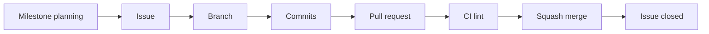

# Workflow

Every change reaches `main` through an issue, a branch and a pull request.
This page shows each step in order.



## Planning

Each milestone starts with a planning session. It groups the milestone's planned work into issues, one outcome each, and produces the issues for that milestone only.

| Output | Where |
|---|---|
| Issues | GitHub, each with a milestone |
| Bigger decisions | ADR in `docs/adr/NNNN-<slug>.md` with Context, Decision and Consequences |

## Issues

Each issue uses the Task form and covers one outcome: about half a day of work, usually 5 to 10 commits, a single session and a single PR. Small chores stay small, and work that does not fit a session splits into more issues. A squash merge turns each issue into a single commit on `main`, so a PR title that needs "and" between unrelated changes means two issues.

| Part | Rule |
|---|---|
| Title | Imperative sentence without a period, e.g. `Add the issue template` |
| Goal | What is true when the work is done, and why, in 1 or 2 sentences |
| Done when | At most 5 outcomes you can see, in plain words, without commands or output, e.g. `Password login over SSH is refused on both hosts` |
| Milestone | Exactly 1 |
| Label | Exactly 1 area for the main change: `repo`, `ansible`, `k8s`, `ci` or `docs`, plus `bug` when it applies |
| Duplicates | Closed as a duplicate with a link to the original, never deleted. An issue merged into a bigger one is closed the same way |

## Branches

Each issue gets its own branch, named `<type>/<issue>-<slug>`. The type is the same as in the commit rules.

| Branch | Use |
|---|---|
| `feat/12-sshd-keys-only` | Work on issue 12 |
| `test/4-lint-error` | Proof PR for issue 4, closed without merge |

## Commits

Commits follow Conventional Commits, always with a scope. The same rules apply to PR titles, because the PR title becomes the commit on `main`.

- The format is `<type>(<scope>): <description>`.
- The description uses the imperative with a lowercase start, e.g. `add`, not `added`.
- The whole title has at most 72 characters and no period at the end.
- A body comes only when the title misses something important, in at most 3 sentences.
- A breaking change gets `!` after the scope, and the body says what to change.
- A commit holds a single logical change, and files go in by name with `git add <path>`.
- Secrets, serial numbers, UUIDs, `.env` files and build output never go in a commit.

| Type | Use |
|---|---|
| `feat` | Something new works: a role, a service, a script |
| `fix` | A correction to something that worked wrong |
| `refactor` | Same behaviour, different code |
| `test` | Only tests or checks |
| `docs` | Only documentation |
| `build` | Only build files and dependencies, e.g. `requirements-dev.txt` |
| `ci` | Only `.github/workflows/` |
| `chore` | Repo upkeep: `.gitignore`, `.gitattributes`, `LICENSE` |

## Commit scopes

The scope is a single lowercase word for the part of the repo that changes. A commit that touches several parts takes the scope of the main change.

| Files | Type and scope |
|---|---|
| `README.md` only | `docs(readme)` |
| Other docs | `docs(<topic>)`, e.g. `docs(workflow)` |
| `.gitignore`, `.gitattributes`, `LICENSE`, rest of `.github/` | `chore(repo)` |
| `.github/workflows/` | `ci(github)` |
| `ansible/` | `<type>(ansible)` |

## Pull requests

The PR body follows the template with two sections: What changes and How it was checked.

| Part | Rule |
|---|---|
| Title | Commit format, at most 66 characters, describes the whole change |
| What changes | 2 or 3 sentences on what the PR does and why |
| Issue link | `Closes #<n>`, or `Refs #<n>` when the proof only works on `main` |
| How it was checked | One short line per "Done when" item with its result, without terminal output |
| Required check | `lint` from the `Lint` workflow: `yamllint --strict .` and `ansible-lint` |
| Proof PR | Branch `test/<issue>-<slug>`, closed without merge, linked from the real PR |

## Merging

The `protect-main` ruleset allows only squash merges into `main`, with signed commits, a passing `lint` check and an up-to-date branch. The squash commit is the PR title with ` (#<pr>)` and an empty body.

1. Check that `lint` passes:

   ```bash
   gh pr checks <pr>
   ```

   Here `<pr>` is the pull request number.

2. Merge the PR. This deletes the local and remote branch and switches to `main`:

   ```bash
   gh pr merge <pr> --squash --delete-branch
   ```

3. Pull the squash commit:

   ```bash
   git pull
   ```

## Closing

Before the merge, I tick each "Done when" box once I have run its check. `Closes #<n>` closes the issue at the merge. A closing comment comes only when the PR does not say something: a follow-up issue, a changed decision, or an issue closed by hand after `Refs`. It uses this format:

```text
Done in #<pr>. <What is true now, or what changed.>

Follow-up: #<n>, #<n>
```

- The comment is one or two sentences.
- `Follow-up:` lists only issue numbers, and only when there are any.
- Anything left over becomes a new issue or goes into an existing one.
- When the last issue of a milestone closes, the README roadmap gets updated and the milestone closes.
